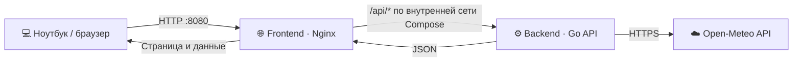
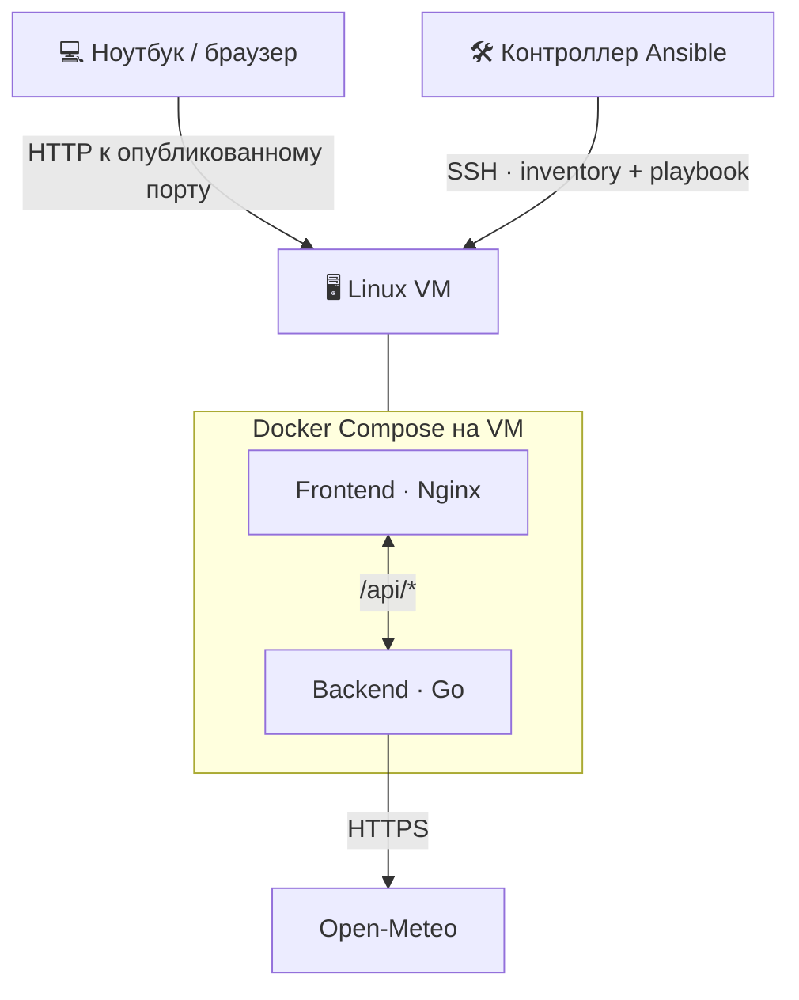

# 🌦️ WeatherWise

**WeatherWise** — учебное веб-приложение для просмотра погоды, построенное из двух сервисов: frontend и backend. Проект демонстрирует взаимодействие HTTP API, контейнеризацию с Docker Compose и подготовку автоматизированного развёртывания с Ansible.

> **Статус проекта:** локальный запуск приложения через Docker Compose проверен. Сценарий KVM/Ansible подготовлен для проверки на совместимом Linux-хосте; фактический запуск Ansible против KVM-виртуальной машины не подтверждён из-за ограничения вложенной виртуализации в проверенной среде WSL на Windows 10. Подробности — в разделе [Ограничение KVM](#️-ограничение-kvm-в-wsl).

## ✨ Что внутри

- **Frontend** — HTML, CSS и JavaScript, раздаваемые Nginx.
- **Backend** — HTTP API на Go, которое получает погодные данные от Open-Meteo и возвращает их в JSON.
- **Docker Compose** — сборка и запуск обоих сервисов одной командой.
- **Ansible** — подготовленный inventory и playbook для развёртывания на отдельной Ubuntu VM.
- **GitHub Actions + Trivy** — автоматизированное сканирование образов на известные уязвимости.

Для получения данных используется [Open-Meteo](https://open-meteo.com/); API не требует ключа. Для работы backend необходим исходящий доступ к сервису.

## 🧭 Архитектура

### Запрос от браузера к погодному API



Браузер обращается к опубликованному порту frontend. Nginx перенаправляет запросы `/api/...` на сервис `backend` внутри сети Docker Compose. Поэтому frontend использует внутреннее имя сервиса `backend`, а не `localhost`: внутри контейнера `localhost` указывает на этот же контейнер.

### Предполагаемая схема развёртывания на VM



Последняя схема описывает **планируемый сценарий** на совместимом Linux-хосте. Она не означает, что KVM VM и Ansible-развёртывание уже были успешно запущены.

## 📁 Структура репозитория

```text
sda_labs/
├── README.md
├── compose.yaml
├── frontend/
│   ├── Dockerfile
│   ├── nginx.conf
│   └── public/
│       ├── index.html
│       ├── app.js
│       └── styles.css
├── backend/
│   ├── Dockerfile
│   ├── go.mod
│   ├── go.sum
│   └── cmd/
│       └── weather-api/
│           └── main.go
├── ansible/
│   ├── inventory.ini
│   └── deploy.yml
├── docs/
│   ├── kvm-limitation.md
│   └── ansible-levels-9-10.md
└── .github/
    └── workflows/
        └── trivy.yml
```

Это ориентир по назначению файлов. В репозитории следует сохранить фактические имена и расположение файлов проекта; документацию из `docs/` добавлять туда после переноса соответствующих материалов.

## 🚀 Запуск приложения

### Требования

- Docker Engine или Docker Desktop;
- Docker Compose v2;
- доступ к Docker Registry для загрузки базовых образов;
- исходящий сетевой доступ к Open-Meteo для получения актуальной погоды.

### 1. Открыть корень репозитория

Перейдите в каталог, в котором лежит `compose.yaml`.

### 2. Собрать образы и запустить сервисы

```bash
docker compose up -d --build
```

### 3. Проверить состояние контейнеров

```bash
docker compose ps
```

Оба сервиса должны быть в рабочем состоянии.

### 4. Открыть страницу

Если в `compose.yaml` порт frontend опубликован как `8080:80`, откройте:

**http://localhost:8080**

Если используется другой внешний порт, замените `8080` на значение слева от двоеточия в секции `ports` сервиса frontend.

При запуске внутри VM используйте её доступный с ноутбука IP-адрес, например `http://<ip-адрес-vm>:8080`. Для этого опубликованный порт должен быть доступен через сеть VM, а правила firewall не должны блокировать соединение.

## 🔎 Как проверить связь frontend и backend

Frontend делает запрос к API через относительный URL:

```text
/api/weather?city=Stockholm
```

Nginx из `frontend/nginx.conf` проксирует `/api/` на `http://backend:8080` внутри сети Compose. Backend получает данные от Open-Meteo и возвращает JSON, который использует frontend.

### Проверка через браузер

1. Откройте WeatherWise.
2. Нажмите `F12` и перейдите во вкладку **Network**.
3. Обновите страницу и найдите запрос `/api/weather?city=Stockholm`.
4. Убедитесь, что запрос завершается успешно и в ответе присутствуют погодные данные в JSON.

### Проверка через терминал

При опубликованном frontend-порту `8080` выполните:

```bash
curl -i "http://localhost:8080/api/weather?city=Stockholm"
```

Ожидается успешный HTTP-ответ с JSON. Если в `compose.yaml` указан другой порт, измените адрес команды.

### Логи при ошибках

```bash
docker compose logs --tail=100
```

Только backend:

```bash
docker compose logs --tail=100 backend
```

Только frontend/Nginx:

```bash
docker compose logs --tail=100 frontend
```

Если страница открывается, но данных нет, сначала проверьте запрос во вкладке Network. Ответ `502` обычно указывает на проблему связи Nginx с backend; ошибка самого API или получения прогноза требует проверки логов backend и исходящего доступа к Open-Meteo.

## 🧰 Полезные команды Docker Compose

Остановить контейнеры, не удаляя их:

```bash
docker compose stop
```

Снова запустить остановленные контейнеры:

```bash
docker compose start
```

Остановить и удалить контейнеры и сеть Compose:

```bash
docker compose down
```

Пересобрать образы и запустить приложение после изменений в исходниках:

```bash
docker compose up -d --build
```

## 🤖 Ansible: автоматизация развёртывания

В каталоге `ansible/` предусмотрены два основных файла:

- `inventory.ini` — адрес целевой машины и пользователь для SSH-подключения;
- `deploy.yml` — проверка/установка инструментов, доставка файлов проекта и запуск Compose.

Предполагаемая архитектура: Ansible запускается в Linux-контроллере и управляет отдельной Ubuntu Server VM по SSH. На целевой машине не требуется устанавливать Ansible, но должны быть доступны SSH, Python и среда, необходимая для Docker Compose.

### Подготовка контроллера

На Ubuntu-контроллере:

```bash
sudo apt update
```

```bash
sudo apt install -y ansible openssh-client
```

Установите коллекцию Docker для Ansible:

```bash
ansible-galaxy collection install community.docker
```

Перед запуском замените пример адреса в `ansible/inventory.ini` на реальный IP целевой VM и настройте SSH-аутентификацию. Пароли и приватные SSH-ключи не следует хранить в репозитории.

### Проверка соединения

```bash
ansible -i ansible/inventory.ini weather_server -m ansible.builtin.ping
```

При успешном подключении ожидаются `SUCCESS` и `pong`.

### Запуск playbook

```bash
ansible-playbook -i ansible/inventory.ini ansible/deploy.yml --ask-become-pass
```

Команда запускает автоматизацию и при необходимости запрашивает пароль для повышения привилегий через `sudo`. После выполнения следует проверить контейнеры и открыть страницу приложения.

Для проверки идемпотентности выполните ту же команду второй раз без ручного изменения состояния VM. Повторный запуск должен завершиться без ошибок; при неизменной конфигурации желательно получить `changed=0`, а frontend и backend должны продолжить работать.

⚠️ **Статус проверки:** из-за недоступности KVM в проверенной среде WSL фактический запуск Ansible против KVM VM не проводился. `inventory.ini`, `deploy.yml` и команды описывают подготовленный сценарий для проверки на совместимом Linux-хосте. Подробное объяснение находится в [`docs/ansible-levels-9-10.md`](docs/ansible-levels-9-10.md).

## 🛡️ GitHub Actions и Trivy

Workflow расположен в `.github/workflows/trivy.yml`. Он предназначен для запуска при изменениях в репозитории, сборки образов приложения и их проверки с помощью [Trivy](https://trivy.dev/).

Trivy ищет известные уязвимости в образах. Найденные уязвимости сами по себе не отменяют бонусное задание: важно, чтобы workflow запускался, сканировал образы, используемые Compose, а результат был виден в GitHub Actions.

**Как проверить:** отправьте изменения в GitHub, откройте вкладку **Actions**, выберите запуск workflow и проверьте журнал этапа Trivy. До появления успешного запуска в Actions наличие YAML-файла само по себе не является подтверждением выполнения сканирования.

## ⚠️ Ограничение KVM в WSL

KVM проверялся на двух ноутбуках с Windows 10:

- Acer Extensa 215-32 с Intel Celeron N4500;
- Lenovo ThinkPad E14 с Intel Core i5-10210U.

В ходе диагностики проверялись конфигурация Windows и WSL, архитектура Linux-среды, наличие флагов `vmx`/`svm` в `/proc/cpuinfo` и устройства `/dev/kvm`. В проверенной среде WSL сообщала о неподдерживаемой вложенной виртуализации; устройство `/dev/kvm` внутри WSL отсутствовало. Попытка использовать более старый выпуск WSL не устранила проблему.

С результатами сопоставляется [Microsoft WSL issue #40735](https://github.com/microsoft/WSL/issues/40735), в котором описано ограничение вложенной виртуализации в некоторых выпусках WSL на Windows 10. Это возможное объяснение наблюдавшихся симптомов, но не доказательство единственной причины для всех конфигураций.

Подробные команды и результаты диагностики, а также предполагаемая последовательность проверки на совместимом Linux-хосте приведены в [`docs/kvm-limitation.md`](docs/kvm-limitation.md). Создание KVM VM и запуск Ansible на ней не следует считать выполненными, пока нет фактических результатов.

## ✅ Краткий чек-лист

- [ ] `docker compose up -d --build` завершается успешно.
- [ ] Страница открывается по опубликованному порту.
- [ ] Запрос `/api/weather?city=Stockholm` возвращает погодные данные.
- [ ] Workflow Trivy запускается в GitHub Actions и показывает результат сканирования.
- [ ] Для сценария Ansible проверены SSH-подключение, первый запуск и повторный запуск на доступной VM.
- [ ] В README и документации различаются фактически проверенные действия и теоретический сценарий KVM.

---

*Учебный проект. WeatherWise предназначен для демонстрации взаимодействия frontend/backend, Docker Compose, Ansible и базового сканирования контейнерных образов.*
